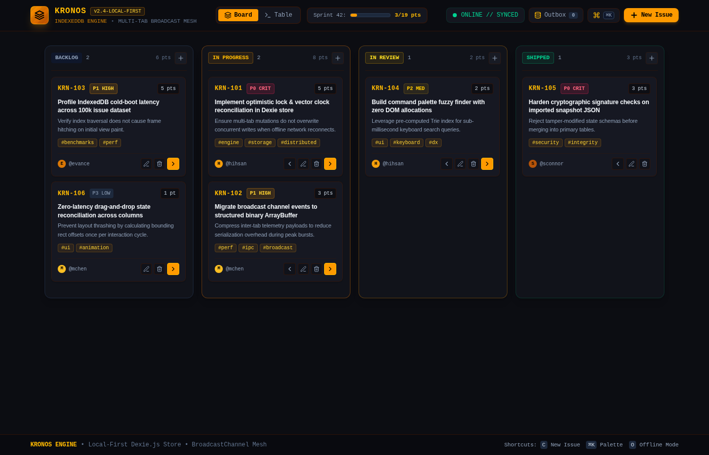

# Kronos // Local-First Task Matrix

A local-first, zero-latency task management engine with browser-native IndexedDB persistence, optimistic outbox mutation queues, and multi-tab broadcast synchronization.



---

## Architecture Overview

Kronos is designed around local-first software architecture principles. The browser database is treated as the primary source of truth, enabling immediate sub-millisecond writes with zero network latency.

```
[ User Action: Keyboard / Drag / Command Palette ]
                       │
                       ▼
         ┌───────────────────────────┐
         │ Optimistic Mutation Bus   │
         └─────────────┬─────────────┘
                       │
         ┌─────────────┴─────────────┐
         ▼                           ▼
┌──────────────────┐       ┌──────────────────┐
│ Dexie IndexedDB  │       │ BroadcastChannel │
│  (Tasks Store)   │       │   (Peer Mesh)    │
└────────┬─────────┘       └─────────┬────────┘
         │                           │
         ▼                           ▼
┌──────────────────┐       ┌──────────────────┐
│ Mutation Outbox  │       │ Real-Time Sync   │
│ (Pending Log)    │       │ In All Open Tabs │
└──────────────────┘       └──────────────────┘
```

## Engineering Highlights

* **Local-First Storage Engine**: Powered by Dexie.js over browser IndexedDB. Queries and mutations execute against local storage with zero round-trip latency.
* **Optimistic Outbox Pattern**: Every create, update, re-order, and delete operation is immediately reflected in the interface and recorded to a local mutation journal.
* **Offline Network Simulation**: Built-in toggle to simulate complete network disconnection. Mutations accumulate in the outbox queue and can be inspected or flushed with transactional replay.
* **Multi-Tab Broadcast Mesh**: Uses the `BroadcastChannel` API to synchronize state across multiple open browser tabs in real time without polling.
* **Linear-Style Command Palette**: Keyboard-driven command search (`Cmd+K` / `Ctrl+K`) for switching views, jumping to issues, and executing batch commands.
* **Dual View Matrix**: Switchable between a tactile 4-stage Kanban board and a dense, sortable issue data grid.

---

## Technical Stack

* **UI Framework**: React 19, TypeScript
* **Styling**: Tailwind CSS v4 (Industrial Amber Dark Palette)
* **Storage Engine**: Dexie.js (IndexedDB wrapper)
* **Build System**: Vite 8, Bun
* **Browser APIs**: IndexedDB API, BroadcastChannel API, Web Storage API

---

## Getting Started

### Prerequisites

Ensure you have [Bun](https://bun.sh) or [Node.js](https://nodejs.org) (v18+) installed.

### Installation

```bash
# Clone repository
git clone git@github.com:hamzaihsan9/kronos-task-engine.git
cd kronos-task-engine

# Install dependencies
bun install
# or
npm install

# Start development server
bun dev
# or
npm run dev
```

The application runs locally on `http://localhost:5174` (or `5173`).

---

## Keyboard Shortcuts

| Shortcut | Description |
| :--- | :--- |
| `C` | Open new issue creation dialog |
| `Cmd+K` / `Ctrl+K` | Open command palette |
| `O` | Toggle offline network disconnection simulation |
| `1` | Switch to Kanban Board view |
| `2` | Switch to Table Data Grid view |
| `Esc` | Close active dialog or palette |

---

## License

MIT License.
